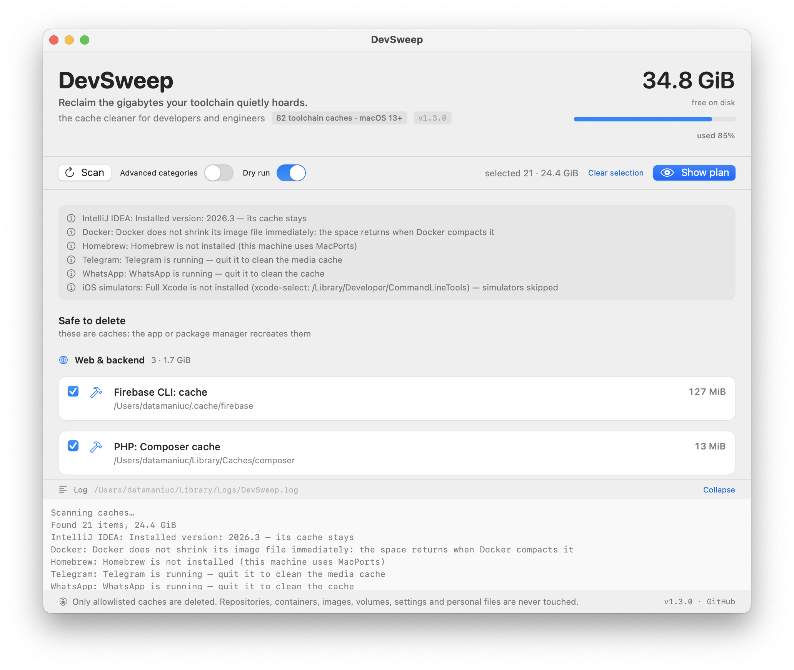

# DevSweep

### Reclaim the gigabytes your toolchain quietly hoards.



DevSweep is a native macOS desktop app **for developers and engineers**, not a
generic "clean your Mac" utility. Those know Downloads and Trash. DevSweep knows
the regenerable caches that Rust, Gradle, Xcode, PlatformIO, Conda, Hugging Face
and dozens of other tools leave behind, groups them by discipline (web, mobile, desktop,
embedded, data/ML) and deletes only what the tool itself rebuilds or
re-downloads. **Dry run is the default**: you see the exact file list and the
exact command before anything is removed.

macOS 13+ · universal binary (Apple silicon + Intel) · ~2 MB · no Electron, no
telemetry, no network access.

## Download

Grab `DevSweep-1.3.0.zip` from the [latest release](https://github.com/atamaniuc/devsweep/releases/latest),
unzip it and open `DevSweep.app`. The bundle is ad-hoc signed, so on first launch
macOS may ask you to confirm with right-click → Open. Release notes live in
[CHANGELOG.md](CHANGELOG.md); the running version is shown in the window and in
the footer link.

## Why it is different from other disk cleaners

- **Built for developers, not for "junk".** A generic cleaner cannot tell a
  Gradle cache from a project. DevSweep ships a catalog of **82 toolchain
  caches** and treats each one with the right tool: `npm cache clean --force`,
  `uv cache clean --force`, `go clean -cache`, `pnpm store prune`, Docker
  `builder prune --filter until=24h`, and plain allowlisted directory removal
  for the rest.
- **Grouped by discipline.** Every cache is tagged web & backend, mobile,
  desktop & native, embedded, or data/ML/cloud — so a full-stack developer, a
  firmware engineer and an ML engineer each see their own list first.
- **Safety is the feature.** Deletions pass a hard allowlist (absolute path, no
  `..`, no symlinks, never `node_modules`/`.git`), repositories, containers,
  images and volumes are never touched, and an app's cache is skipped while that
  app is running.
- **Honest about cost.** Caches that come back slowly (dependency caches, model
  weights, DerivedData) are grouped separately as *advanced*, each with a
  warning saying what will be re-downloaded or rebuilt.
- **A real macOS app.** SwiftUI, one small universal binary, keyboard-native,
  light/dark aware, UI in the system language (English or Russian).

## What it cleans

The table below is **generated from the app's own catalog**
(`Sources/Models.swift`, `ToolCaches.specs`) and checked by `--self-test`, so the
documentation cannot drift from what the app actually supports. *safe* = pure
cache, recreated instantly or on the next use; *advanced* = re-downloaded or
rebuilt, slower.

<!-- tools:begin -->

### Web & backend

| Tool | Cache path | Class |
| --- | --- | --- |
| Yarn: package cache | `~/Library/Caches/Yarn` | safe |
| Yarn Berry: global cache | `~/.yarn/berry/cache` | advanced |
| npm: npx cache | `~/.npm/_npx` | safe |
| Node: node-gyp headers | `~/.cache/node-gyp` | safe |
| Firebase CLI: cache | `~/.cache/firebase` | safe |
| Deno: module cache | `~/Library/Caches/deno` | safe |
| Cypress: binaries and cache | `~/Library/Caches/Cypress` | safe |
| Puppeteer: browsers | `~/.cache/puppeteer` | safe |
| Selenium: drivers and browsers | `~/.cache/selenium` | safe |
| Playwright: browsers | `~/Library/Caches/ms-playwright` | advanced |
| PHP: Composer cache | `~/Library/Caches/composer` | safe |
| Ruby: Bundler cache | `~/.bundle/cache` | safe |
| Elixir: Hex packages | `~/.hex/packages` | safe |
| Erlang: rebar3 cache | `~/.cache/rebar3` | safe |

### Mobile

| Tool | Cache path | Class |
| --- | --- | --- |
| Gradle: dependency caches | `~/.gradle/caches` | advanced |
| Gradle: wrapper distributions | `~/.gradle/wrapper/dists` | safe |
| Android: SDK cache | `~/.android/cache` | safe |
| Android: system images | `~/Library/Android/sdk/system-images` | advanced |
| CocoaPods: pod cache | `~/Library/Caches/CocoaPods` | safe |
| CocoaPods: spec repositories | `~/.cocoapods/repos` | advanced |
| Dart/Flutter: pub cache | `~/.pub-cache` | safe |
| fastlane: cache | `~/Library/Caches/fastlane` | safe |
| Kotlin/Native cache | `~/.konan` | advanced |
| Xcode: DerivedData | `~/Library/Developer/Xcode/DerivedData` | advanced |
| Xcode: iOS DeviceSupport | `~/Library/Developer/Xcode/iOS DeviceSupport` | advanced |
| Xcode: Previews | `~/Library/Developer/Xcode/UserData/Previews` | advanced |
| CoreSimulator: caches | `~/Library/Developer/CoreSimulator/Caches` | safe |

### Desktop & native

| Tool | Cache path | Class |
| --- | --- | --- |
| Rust: crates cache | `~/.cargo/registry/cache` | safe |
| Rust: extracted crate sources | `~/.cargo/registry/src` | safe |
| Rust: git dependencies | `~/.cargo/git` | advanced |
| C/C++: ccache | `~/.cache/ccache` | safe |
| C/C++: clangd indexes | `~/.cache/clangd/index` | safe |
| Bazel: output base | `~/.cache/bazel` | safe |
| Bazelisk: downloaded bazel | `~/Library/Caches/bazelisk` | safe |
| C/C++: Conan 2 packages | `~/.conan2/p` | advanced |
| C/C++: vcpkg archives | `~/.cache/vcpkg` | safe |
| Go: build cache | `~/Library/Caches/go-build` | safe |
| Go: module cache | `~/go/pkg/mod` | advanced |
| Swift: SPM cache | `~/Library/Caches/org.swift.swiftpm` | safe |
| .NET: NuGet global packages | `~/.nuget/packages` | advanced |
| .NET: NuGet package cache | `~/.local/share/NuGet` | advanced |
| .NET: NuGet HTTP cache | `~/Library/Caches/NuGet` | advanced |
| Electron: downloaded versions | `~/Library/Caches/electron` | safe |
| electron-builder: cache | `~/Library/Caches/electron-builder` | safe |
| Unity: package cache | `~/Library/Unity/cache` | safe |
| Unreal Engine: DerivedDataCache | `~/Library/Application Support/Epic/UnrealEngine/Common/DerivedDataCache` | advanced |
| Zig: cache | `~/.cache/zig` | safe |
| VS Code: cache | `~/Library/Application Support/Code/Cache` | safe |
| VS Code: cached data | `~/Library/Application Support/Code/CachedData` | safe |
| VS Code Insiders: cache | `~/Library/Application Support/Code - Insiders/Cache` | safe |
| Cursor: cache | `~/Library/Application Support/Cursor/Cache` | safe |
| Cursor: cached data | `~/Library/Application Support/Cursor/CachedData` | safe |

### Embedded

| Tool | Cache path | Class |
| --- | --- | --- |
| PlatformIO: platforms and toolchains | `~/.platformio/packages` | advanced |
| PlatformIO: build cache | `~/.platformio/.cache` | safe |
| ESP-IDF: distributions | `~/.espressif/dist` | safe |
| ESP-IDF: toolchains | `~/.espressif/tools` | advanced |
| ESP-IDF: python env | `~/.espressif/python_env` | advanced |
| Arduino: staging | `~/Library/Arduino15/staging` | safe |
| Arduino: downloaded cores | `~/Library/Arduino15/packages` | advanced |
| arduino-cli: cache | `~/.cache/arduino` | safe |
| TinyGo: build cache | `~/.cache/tinygo` | safe |

### Data, ML & cloud

| Tool | Cache path | Class |
| --- | --- | --- |
| Python: pip cache | `~/Library/Caches/pip` | safe |
| Python: Poetry cache | `~/Library/Caches/pypoetry` | safe |
| Python: pre-commit environments | `~/.cache/pre-commit` | safe |
| Conda: packages (miniconda3) | `~/miniconda3/pkgs` | advanced |
| Conda: packages (anaconda3) | `~/anaconda3/pkgs` | advanced |
| Conda: packages (miniforge3) | `~/miniforge3/pkgs` | advanced |
| Conda: packages (/opt/miniconda3) | `/opt/miniconda3/pkgs` | advanced |
| Conda: packages (/opt/anaconda3) | `/opt/anaconda3/pkgs` | advanced |
| Hugging Face: models | `~/.cache/huggingface` | advanced |
| Ollama: models | `~/.ollama/models` | advanced |
| LM Studio: models | `~/.lmstudio/models` | advanced |
| PyTorch: model cache | `~/.cache/torch` | advanced |
| Whisper: models | `~/.cache/whisper` | advanced |
| JVM: Coursier cache | `~/Library/Caches/Coursier/v1` | safe |
| Scala: sbt boot | `~/.sbt/boot` | safe |
| Scala/Java: ivy cache | `~/.ivy2/cache` | safe |
| Maven: local repository | `~/.m2/repository` | advanced |
| Helm: chart cache | `~/Library/Caches/helm/repository` | safe |
| kubectl: discovery cache | `~/.kube/cache` | safe |
| Terraform: plugin cache | `~/.terraform.d/plugin-cache` | safe |
| Nix: cache | `~/.cache/nix` | safe |

<!-- tools:end -->

Beyond the toolchain catalog, DevSweep also cleans:

- **Package managers**: npm, pnpm store, bun, Homebrew, MacPorts.
- **IDEs**: JetBrains caches of IDE versions that are not installed (never the
  running one), VS Code and Cursor caches.
- **Containers**: Docker build cache older than 24 h and dangling images only.
- **System**: `/private/tmp` scratch older than 14 days, unavailable iOS
  simulators.
- **Messengers** (advanced): Telegram and WhatsApp media caches, skipped while
  the app is running.

## Safety model

- Every deletion goes through a hard allowlist: absolute path, no `..`, no
  symlinks, no `node_modules`/`.git`, only known cache directories plus
  `/private/tmp` scratch entries.
- Repositories, containers, images, volumes, settings and personal files are
  never touched.
- Commands are a fixed whitelist with hard per-command timeouts; Docker is only
  `builder prune --filter until=24h` and dangling `image prune -f` (never `-a`,
  never volumes).
- An app's cache is skipped while that app is running (IntelliJ, Telegram,
  WhatsApp).
- Nothing is deleted without your click: dry run lists files, then a separate
  confirmation is required with dry run off.
- No network access, no analytics, no accounts.

## Build and run

Needs macOS 13+ and the Command Line Tools (Swift toolchain); there is no Xcode
project and no dependency to fetch.

```bash
./build.sh                        # universal: arm64 + x86_64
ARCHS="$(uname -m)" ./build.sh    # host slice only, for quick iteration
open build/DevSweep.app
```

`build.sh` compiles both slices, `lipo`s them into one binary and **fails** if
either slice is missing, so a release can never be single-architecture. The
bundle is ad-hoc signed and lives in `build/DevSweep.app`.

## Tests and headless modes

```bash
# the release gate: allowlist, catalog, README sync, delete path (exit code checked)
./build/DevSweep.app/Contents/MacOS/DevSweep --self-test

# scan only: timing and detected items
./build/DevSweep.app/Contents/MacOS/DevSweep --scan

# the toolchain catalog: plain text / markdown (used to regenerate this README)
./build/DevSweep.app/Contents/MacOS/DevSweep --tools
./build/DevSweep.app/Contents/MacOS/DevSweep --tools-md

# full dry-run report (the same list the preview sheet shows)
./build/DevSweep.app/Contents/MacOS/DevSweep --preview /tmp/devsweep-plan.txt
```

`--self-test` runs no destructive action against real caches; its delete check
uses a scratch directory under `/private/tmp`. It also compares the table above
with the compiled catalog and fails when they differ — regenerate it after
changing the catalog:

```bash
./scripts/update-readme-tools.sh
```

## Releases

Releases are automated: pushing a version tag builds a universal bundle on
GitHub Actions, runs `--self-test`, zips the app and creates (or updates) the
release with notes taken from `CHANGELOG.md`.

```bash
# 1. bump CFBundleShortVersionString/CFBundleVersion in Info.plist
# 2. add a "## <version>" section to CHANGELOG.md  (the pipeline refuses to
#    publish without release notes)
# 3. commit, tag, push
git tag v1.3.0 && git push origin v1.3.0
```

Workflow: [.github/workflows/release.yml](.github/workflows/release.yml).

## Performance

Scanning runs every category in parallel and sizes caches with `du`. The dry-run
file list uses a small C walker (`Sources/fastwalk.c`) because Swift's
`FileManager` enumeration was the bottleneck:

| step | before | after |
| --- | --- | --- |
| scan, sequential → parallel scanners | 18.3 s | 6.1 s |
| dry run over ~300k files (scan + walk + report) | 41 s | 15.4 s |

Deletion is syscall-bound (measured with `--bench-delete` on fake 20k-file
trees): `FileManager.removeItem` 2.52 s, `/bin/rm -rf` 2.66 s, embedded C
`rmtree` 2.77 s — so the app uses the C walker but does not pretend a language
change would help.

Logs go to `~/Library/Logs/DevSweep.log`.

## License

MIT — see [LICENSE](LICENSE).
